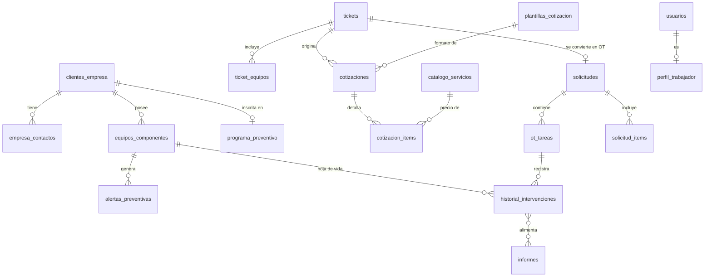
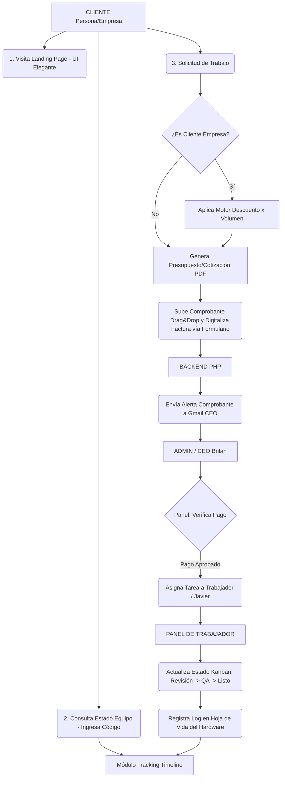
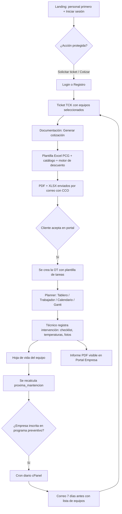

# 📄 Documentación Arquitectónica y de Diseño: Plataforma PCG

Este documento centraliza todas las decisiones técnicas, de arquitectura y diseño UI/UX discutidas para el desarrollo de la plataforma de PCG. Servirá como guía base para la implementación y como respaldo del proyecto.

## 1. Visión General y Arquitectura de Roles

El sistema consta de dos grandes bloques:
*   **Portal Público:** Landing page corporativa elegante, motor de búsqueda de estado de equipos y formulario dinámico de solicitudes. **Orden de la landing (v3):** barra superior con *Iniciar sesión* → hero → **presentación del personal primero** (tarjetas arrastrables) → accesos rápidos (Solicitar ticket, Consultar estado, Registrarse). Ver sección 3.1.
*   **Portal Privado (Dashboard Multi-Rol):** Gestión administrativa, técnica y documental. Incluye el **Portal Empresa** (equipos e historial de mantenciones), **tickets y cotizaciones desde plantilla Excel**, **alertas preventivas**, **informes** y el **planner de OT** del administrador (secciones 4.5 a 4.9).

**Matriz de Permisos (RBAC - Role-Based Access Control):**
*   **Administrador / CEO (Brilan Bugueño):** Acceso total. Aprobación de pagos, edición del motor de descuentos, asignación de tareas a personal técnico, generación de cotizaciones y reportes. **Nuevo (v3):** crea OT, crea y gestiona trabajadores, inscribe empresas en el programa de alertas preventivas, administra el catálogo de servicios y las plantillas de cotización, y es el único rol que ve costos internos y márgenes.
*   **Ing. de Documentación y Procesos (Yovylin):** Emisión de cotizaciones, carga de contratos, revisión de comprobantes de pago y generación de archivos PDF.
*   **Diseñador / Staff Técnico (Javier Vergara / Trabajadores):** Panel exclusivo con tareas asignadas, cambio de estados técnicos y log de intervenciones por equipo.
*   **Cliente Empresa (B2B):** Vista corporativa con historial de equipos, solicitudes activas, cotizaciones recibidas y contratos vigentes. **Nuevo (v3):** ficha de cada equipo con su historial de mantenciones, informes descargables, próxima mantención y apertura de tickets (sección 4.5).
*   **Cliente Particular (B2C):** Vista simplificada con historial de servicios y carga de comprobantes.

## 2. Stack Tecnológico y Despliegue (Hosting)

*   **Frontend:** React (inicializado con Vite) o Next.js configurado en modo **Static Export** (`output: 'export'`).
*   **Backend:** API REST construida en **PHP** (nativo o framework ligero).
*   **Base de Datos:** MySQL / MariaDB.
*   **Hosting:** Plan compartido en **Web Host Chile (cPanel)**.
*   **Estrategia de Despliegue:**
    *   El Frontend se compila en local (archivos HTML/CSS/JS estáticos) y se sube vía FTP o Administrador de Archivos a la raíz `public_html`. Esto garantiza máxima velocidad y compatibilidad en cPanel.
    *   El Backend (PHP) se aloja en el mismo servidor (ej. subcarpeta `public_html/api/`) procesando la lógica de negocio, bases de datos y correos.

## 3. Guía de Estilo y UI/UX (Diseño Premium)

El objetivo visual es proyectar una imagen corporativa de alto nivel, sólida y moderna (estilo Silicon Valley, simulando un equipo de desarrollo masivo).

*   **Tema Base:** Modo Oscuro (Dark Theme) para un look tecnológico y elegante.
    *   *Fondo principal:* Gris pizarra profundo (Ej. `#0f172a`).
    *   *Tarjetas/Paneles:* Gris ligeramente más claro (Ej. `#1e293b`).
*   **Colores de Acento (Extraídos del Logo PCG):**
    *   **Verde PCG:** Color primario para llamadas a la acción (Botones "Guardar", "Aprobar", estado "Listo").
    *   **Rojo PCG:** Color secundario para alertas, fallos, o detalles sutiles de UI.
*   **Tipografía:**
    *   *Títulos y Encabezados:* **Outfit** o **Geist Sans** (Geométrica, limpia).
    *   *Cuerpo de Texto y Tablas:* **Inter** (Máxima legibilidad corporativa).
*   **Diseño de Secciones:**
    *   *Sección "Nuestro Equipo" (v3):* reemplaza el zig-zag por **tarjetas arrastrables** (Aceternity *Draggable Cards*) con el personal. El zig-zag 50/50 queda como alternativa para la página interna "Quiénes somos". Ver 3.1.
*   **Efectos y Micro-interacciones (Framer Motion / GSAP):**
    *   **Glassmorphism:** Modales y menús con desenfoque de fondo.
    *   **Scroll Reveal:** Elementos que aparecen suavemente (`opacity` y `translateX`) al hacer scroll.
    *   **Hover Effects:** Micro-escalado y resplandor radial tras las fotos/tarjetas al pasar el ratón.

### 3.1 Landing pública (v3): estructura y componentes

**Librería de UI:** shadcn/ui sobre Tailwind, con componentes del registro **Aceternity** (`@aceternity`). Se instalan con:

```bash
npx shadcn@latest add @aceternity/draggable-cards
npx shadcn@latest add @aceternity/cloud-shader-hero-demo
```

**Orden de secciones (de arriba hacia abajo):**

| # | Sección | Contenido | Componente |
|---|---|---|---|
| 0 | Barra superior fija | Logo PCG · Equipo · Servicios · Estado de equipo · **Iniciar sesión** (botón verde) · Registrarse | `Navbar` propio (glassmorphism) |
| 1 | Hero | Titular corporativo + maqueta enmarcada del panel sobre cielo/nubes animadas | `cloud-shader-hero-demo` |
| 2 | **Nuestro equipo** (primera sección de contenido) | 3 tarjetas arrastrables con foto, nombre y títulos | `draggable-cards` |
| 3 | Accesos rápidos | *Solicitar ticket / cotización*, *Consultar estado de equipo*, *Programa preventivo para empresas* | Tarjetas con CTA |
| 4 | Cómo trabajamos | Timeline Recibido → Revisión → Reparación → QA → Listo | Timeline |
| 5 | Pie | Contacto, garantía de 30 días, enlaces legales | Footer |

**Reglas de acceso desde la landing:**
*   *Consultar estado* es público (código + RUT/correo, ver 6).
*   *Solicitar ticket*, *Cotizar* y *Programa preventivo* son **acciones protegidas**: si no hay sesión, redirigen a **Iniciar sesión / Registrarse** y, al terminar, vuelven a la acción original (`?next=/tickets/nuevo`).
*   Tras iniciar sesión el usuario aterriza en su panel según el rol (RBAC de la sección 1).

**Personal presentado (datos en `equipo_miembros`, editables desde el panel):**

| Persona | Títulos |
|---|---|
| **Yovylin Bugueño** | Ingeniera Civil Industrial · Licenciatura |
| **Brilan Bugueño** | Licenciado en Ciencias de la Ingeniería Informática · Ingeniero Informático |
| **Johan Carrasco** | Ingeniero en Seguridad Privada · Prevencionista de Riesgos con menciones penales |

> [!NOTE]
> Las tarjetas necesitan una foto vertical recortada por persona. Hoy solo existe la de Yovylin (`Perosnal emrpesa/Foto perfil yovilyn.jpeg`), que trae la marca "Escaneado con CamScanner" abajo y debe recortarse o reemplazarse. Faltan las fotos de Brilan y Johan.

**Referencia visual del dashboard interno:** [dashboard-referencia.jpg](docs/referencias/dashboard-referencia.jpg). Se toma como guía de layout y se adapta a PCG:

*   Barra lateral izquierda con secciones (Inicio, Tickets, OT, Equipos, Empresas, Informes, Personal, Ajustes).
*   Fila de **tarjetas KPI** arriba (tickets abiertos, OT activas, tiempo medio de entrega, cotizaciones aceptadas).
*   **Pipeline Overview** en bloques: Recibido → Revisión → Reparación → QA → Listo → Entregado, con el porcentaje de paso entre etapas.
*   **Tabla por técnico** (OT asignadas, tiempo medio por etapa, entregadas) con buscador, filtros y exportación.
*   Panel lateral derecho con métricas y anotaciones.
*   Selector de rango de fechas y botón *Exportar*.

**Decisión de estilo pendiente:** la referencia y el hero con nubes son **claros (cielo azul)**, mientras que la guía de la sección 3 define tema oscuro. Opciones: (a) hero claro y resto oscuro, (b) todo claro con acentos verde/rojo PCG, (c) hero con cielo oscuro. Ver sección 7.

## 4. Módulos Críticos del Sistema

1.  **Tracking y Línea de Tiempo (Público):**
    *   Buscador rápido por Código Único (ej: PCG-2026-8921) o RUT.
    *   Estados: Recibido/Taller ➔ Revisión/Diagnóstico ➔ Reparación/Desarrollo ➔ QA (Pruebas) ➔ Listo para Entrega.
2.  **Registro Técnico Adaptativo y Motor de Descuentos (B2B/B2C):**
    *   Formulario inteligente con condicionales para Empresas vs Personas Naturales.
    *   **Captura de Hardware Detallado:** Al registrar un equipo, el sistema exige especificaciones clave: *Procesador (CPU), Tipo de Disipación (Líquida o por Aire), Memoria RAM y Tarjeta Gráfica (si posee).*
    *   **Control de Mantenciones Previas:** Selector para indicar si el equipo ingresa por mantención, solicitando la *Fecha de la Última Mantención* para tener un contexto claro del equipo.
    *   Reglas paramétricas para descuento automático por volumen (Ej: 3 a 5 equipos = 25% dcto).
3.  **Cotizaciones Automáticas, Pagos y Facturación:**
    *   Generador de PDF para clientes frecuentes y nuevos.
    *   Integración vía API Gmail / SMTP para despacho automático (con CCO a la empresa).
    *   Dropzone para subir comprobantes (hasta 10MB) y validación manual desde el dashboard de CEO.
    *   **Gestión de Facturas:** Formulario integrado para registrar los datos de facturación de cada servicio, permitiendo digitalizar y adjuntar la factura final para el respaldo de la empresa y del cliente.
4.  **Panel Interno (Dashboard):**
    *   Tablero Kanban global para administración de proyectos.
    *   Vistas limpias exclusivas por trabajador con formulario rápido para adjuntar "Notas del Diagnóstico" a la hoja de vida del equipo.

### 4.5 Portal Empresa: equipos e historial de mantenciones (v3)

El cliente B2B ve **solo los equipos de su empresa** (`equipos_componentes.id_empresa`), compartidos por todos los contactos de `empresa_contactos`.

*   **Listado de equipos:** código de activo, área o usuario final, tipo, marca/modelo, CPU/RAM/GPU/disipación, estado (en poder del cliente o en taller) y **próxima mantención** con semáforo (verde: más de 30 días, amarillo: menos de 30, rojo: vencida).
*   **Ficha del equipo (hoja de vida):** línea de tiempo con cada intervención: fecha, tipo (preventivo, correctivo, upgrade, software), técnico, resumen, **temperatura CPU antes/después**, garantía vigente y documentos adjuntos. Solo se muestran las filas con `visible_cliente = TRUE`.
*   **Informes descargables** (4.8) por equipo, por OT o del parque completo.
*   **Acciones:** abrir ticket sobre uno o varios equipos seleccionados, solicitar cotización, ver el estado de las OT activas.
*   **No ve:** costos internos, notas internas de tickets ni equipos de otras empresas. Toda consulta filtra por la empresa de la sesión en el backend, nunca por un parámetro enviado por el navegador.

### 4.6 Tickets y cotización desde plantilla Excel (v3)

**Ticket:** es la puerta de entrada del cliente (`tickets`). Tipos: cotización, mantención, soporte, consulta. El cliente elige los equipos (`ticket_equipos`), describe el problema y recibe el código `TCK-AAAA-NNNN`. Hay hilo de mensajes con **notas internas** que el cliente no ve.

**Plantilla base:** `Cotizacion_Formal_PCG_SPA.xlsx` (Escritorio), con 5 hojas:

| Hoja | Uso |
|---|---|
| Convenio Corporativo (9 Eq) | Normal vs. convenio por equipo y total del parque |
| Opción Esencial (Mantención) | Solo mantención preventiva |
| Opción Avanzada (Super Pack) | Mantención + optimización + dashboard de inventario |
| Mantención + Avast Ult (9 Eq) | Mantención + licencia antivirus |
| `_DataGraficos` (oculta) | Datos de gráficos |

Condiciones de la plantilla, que pasan a `config_empresa`: pago 50% al inicio y 50% contra recepción conforme, ejecución en 1 a 2 jornadas hábiles, validez de 15 días hábiles, garantía de 30 días.

**Hallazgo técnico:** en el Excel los precios y la cantidad de equipos están **escritos fijos** (`=45000`, `=F14*9`). Para automatizar hay que parametrizar. El sistema guarda el libro como `plantillas_cotizacion` con un **mapa de celdas** (`mapa_celdas_json`: cliente, RUT, contacto, nº de cotización, fecha, fila inicial de ítems, celda de cantidad de equipos). Los precios salen de `catalogo_servicios` y `paquetes_servicio`, y la cantidad sale del ticket.

**Flujo de generación (rol Documentación o Admin):**
1.  Abre el ticket y pulsa **Generar cotización**.
2.  Elige plantilla y paquete (o arma ítems sueltos desde el catálogo). La cantidad de equipos se toma del ticket.
3.  El motor calcula subtotal normal, descuento (`reglas_descuento` o precio convenio por ítem), total y ahorro.
4.  **Vista previa** editable. Al emitir se asigna el número `COT-AAAA-NNN-SUFIJO` y se guarda una copia fija en `datos_snapshot_json`.
5.  Se generan **PDF** y **XLSX editable** y se envían por correo con copia oculta (CCO) a PCG. El ticket pasa a *Cotizado*.
6.  El cliente pulsa **Aceptar** en su portal. El ticket pasa a *Aceptado* y se crea la **OT** (4.9) con los equipos e ítems cotizados.

**Cómo se generan los archivos (restricción del hosting compartido):** no hay Excel ni LibreOffice en cPanel.
*   **XLSX:** PhpSpreadsheet abre la plantilla, escribe las celdas mapeadas y conserva fórmulas y formato. Los `.xlsm` con macros no se pueden usar como base, porque las macros se pierden.
*   **PDF:** se genera con Dompdf desde una **réplica HTML** de la plantilla. Se toma como referencia visual `Cotizacion_Formal_PCG_SPA_9Equipos.pdf`. Convertir el XLSX a PDF directamente en PHP pierde formato y gráficos.
*   Las demás plantillas de `Exel plantillas` (factura, mantenimiento preventivo, programa de mantenimiento de equipos) sirven de **referencia de diseño** para facturas e informes. Solo `.xlsx` sin macros se pueden usar como base automática.

> [!WARNING]
> **Costos y márgenes** (por ejemplo, costo de licencia vs. precio de venta que aparece en `Notas_Cotizaciones_PCG_SPA.txt`) viven en `catalogo_servicios.costo_interno` y solo los ve el Admin. No deben salir en el PDF ni en el XLSX del cliente. El documento tampoco guarda datos bancarios: se cargan en `config_empresa` desde el panel.

### 4.7 Alertas preventivas por empresa (v3)

Aviso por correo **7 días antes** de la mantención sugerida, solo para las empresas que el admin inscribe.

*   **Inscripción (Admin → Empresas → Programa preventivo):** se activa por empresa en `programa_preventivo`, con periodicidad en meses (por defecto 6), días de aviso (por defecto 7), correos de destino (o los contactos con `recibe_alertas`) y copia interna a PCG. Se puede pausar sin perder el historial.
*   **Fecha de mantención:** `proxima_mantencion = fecha_ultima_mantencion + periodicidad_meses`, editable por equipo. Al cerrar una OT de mantención se recalcula sola.
*   **Envío:** un **cron diario de cPanel** (`php /home/USUARIO/api/cron/alertas.php`, por ejemplo 08:00) busca alertas con `fecha_aviso <= hoy` y estado pendiente, y manda **un solo correo por empresa** con la lista de equipos y fechas. `UNIQUE (id_equipo, fecha_programada)` evita duplicados si el cron corre dos veces. Cada envío queda en `notificaciones_email`.
*   **Contenido del correo:** equipos que vencen, fecha de su última mantención y un botón *Agendar mantención*, que lleva al login y crea un ticket con esos equipos ya seleccionados (estado de la alerta: *Agendada*).
*   **Equipos sin fecha base:** el panel los marca para completar el dato. Sin fecha no se puede calcular la alerta.
*   **Panel Admin:** empresas inscritas, alertas por enviar esta semana, enviadas, con error y vencidas.

### 4.8 Generador de informes (v3)

| Tipo | Responde a | Contenido |
|---|---|---|
| **Equipo** | "¿Qué se le hizo a este PC?" | Ficha de hardware + todas las intervenciones con fecha, técnico y checklist |
| **OT** | "¿Qué se hizo en este trabajo?" | Equipos tratados, tareas hechas, tiempos, resultados y garantía |
| **Parque empresa** | Estado general de la flota | Inventario, estado de salud, últimas y próximas mantenciones |
| **Período** | Resumen entre dos fechas | Servicios realizados, equipos intervenidos, indicadores |

*   **Contenido típico de un informe de equipo:** datos del cliente, hardware, trabajos realizados (checklist: desarme y limpieza, pasta térmica, ventiladores, SO, drivers, antivirus), insumos usados, **temperaturas antes y después** (la plantilla usa 85 °C → 48 °C como ejemplo), fotos antes y después, recomendaciones, garantía (30 días por defecto) y próxima mantención sugerida.
*   **Flujo:** el técnico completa la intervención (checklist, temperaturas, fotos) → Documentación o Admin genera el informe → edita el `resumen` → emite el PDF con Dompdf → marca *visible para el cliente*.
*   **Un informe emitido no cambia:** guarda un snapshot en `contenido_json`, de modo que editar el equipo después no altera el informe ya entregado.
*   Se puede **enviar por correo** desde el panel y queda disponible en el Portal Empresa (4.5).

### 4.9 Administración: OT, planner y personal (v3)

**Crear OT (solo Admin y Documentación):** manualmente, desde un ticket aceptado o desde una alerta preventiva (`origen`: ADMIN, TICKET o PREVENTIVA). Datos: cliente o empresa, equipos, título, tipo de servicio, prioridad, fechas planificadas y responsable. Al crearla se aplica una **plantilla de tareas** según el servicio (por ejemplo, mantención: recepción y fotos → diagnóstico → limpieza y pasta térmica → SO y drivers → QA térmico → informe → entrega).

**Planner de OT** (inspirado en Microsoft Planner, con más control). Vistas sobre los mismos datos:

| Vista | Para qué |
|---|---|
| **Tablero** | Kanban por estado de la OT con arrastrar y soltar |
| **Por trabajador** | Carriles por técnico con **carga** (horas asignadas vs. `horas_semanales`) |
| **Calendario** | Fechas de inicio y límite, con alertas preventivas superpuestas |
| **Línea de tiempo (Gantt)** | OT y tareas con **dependencias** (`depende_de`) y detección de atrasos |
| **Lista** | Tabla filtrable (prioridad, responsable, empresa, fecha) con exportación |

Cada OT contiene tareas (`ot_tareas`) con responsable, prioridad, fechas, horas estimadas y reales, checklist, comentarios y adjuntos. Los cambios de estado de la OT alimentan el timeline público.

**Gestión de personal (Admin):** crear trabajadores con nombre, correo, rol, cargo, título, horas semanales y color en el planner. La contraseña es temporal (`debe_cambiar_password`). Se **desactivan** en lugar de borrarse, para no perder el historial de intervenciones. También se puede restablecer clave y editar las tarjetas públicas del equipo (`equipo_miembros`).

**Dashboard del Admin** (layout de [dashboard-referencia.jpg](docs/referencias/dashboard-referencia.jpg)): KPIs (tickets abiertos, OT activas, atrasadas, cotizaciones pendientes), pipeline por estado, carga por técnico y alertas preventivas de la semana.

## 5. Arquitectura de Base de Datos (Modelo ER Extendido)

Fusión del modelo base de negocio con la arquitectura específica de hardware:

```sql
-- TABLA DE USUARIOS Y ROLES
CREATE TABLE usuarios (
    id_usuario INT PRIMARY KEY AUTO_INCREMENT,
    nombre VARCHAR(100) NOT NULL,
    email VARCHAR(100) UNIQUE NOT NULL,
    password_hash VARCHAR(255) NOT NULL,
    rol ENUM('ADMIN', 'DOC_PROCESS', 'WORKER', 'CLIENTE_PERSONA', 'CLIENTE_EMPRESA') NOT NULL,
    telefono VARCHAR(20),
    creado_en TIMESTAMP DEFAULT CURRENT_TIMESTAMP
);

-- PERFILES DE EMPRESA (B2B)
CREATE TABLE clientes_empresa (
    id_empresa INT PRIMARY KEY AUTO_INCREMENT,
    id_usuario INT,
    razon_social VARCHAR(150) NOT NULL,
    rut_empresa VARCHAR(20) UNIQUE NOT NULL,
    giro VARCHAR(100),
    FOREIGN KEY (id_usuario) REFERENCES usuarios(id_usuario)
);

-- REGISTRO DE EQUIPOS Y COMPONENTES HARDWARE
CREATE TABLE equipos_componentes (
    id_equipo INT PRIMARY KEY AUTO_INCREMENT,
    id_usuario INT NOT NULL, 
    id_equipo_padre INT NULL, -- Permite vincular componentes menores (GPU) a un equipo mayor (Desktop)
    tipo_hardware ENUM('DESKTOP', 'LAPTOP', 'TARJETA_GRAFICA', 'PLACA_MADRE', 'SERVIDOR', 'WEBAPP', 'OTRO') NOT NULL,
    marca VARCHAR(50) NOT NULL,
    modelo VARCHAR(100) NOT NULL,
    numero_serie VARCHAR(100),
    
    -- DATOS DE HARDWARE CLAVE (Extraídos del JSON para fácil filtrado y reportes)
    procesador VARCHAR(150),
    ram_gb INT,
    tipo_disipacion ENUM('AIRE', 'LIQUIDA', 'STOCK', 'OTRO') DEFAULT 'STOCK',
    tarjeta_grafica VARCHAR(150),
    
    especificaciones_json JSON, -- Atributos dinámicos extra (ej: Watts de Fuente de poder, Tipo de placa madre)
    fecha_ultima_mantencion DATE NULL, -- Control de cuándo fue intervenido por última vez
    fotos_recepcion_json JSON, -- Respaldo visual del estado físico al recibir
    estado_ubicacion ENUM('EN_PODER_CLIENTE', 'EN_TALLER_PCG', 'DADO_DE_BAJA') DEFAULT 'EN_PODER_CLIENTE', 
    fecha_registro TIMESTAMP DEFAULT CURRENT_TIMESTAMP,
    FOREIGN KEY (id_usuario) REFERENCES usuarios(id_usuario),
    FOREIGN KEY (id_equipo_padre) REFERENCES equipos_componentes(id_equipo) ON DELETE SET NULL
);

-- SOLICITUDES, ÓRDENES DE TRABAJO Y PAGOS
CREATE TABLE solicitudes (
    id_solicitud INT PRIMARY KEY AUTO_INCREMENT,
    codigo_seguimiento VARCHAR(20) UNIQUE NOT NULL, -- Código público para el Timeline
    id_usuario INT NOT NULL,
    id_equipo INT,
    id_tecnico_asignado INT,
    tipo_servicio ENUM('MANTENIMIENTO', 'DESARROLLO', 'UPGRADE', 'CONSULTORIA'),
    estado ENUM('RECIBIDO', 'EN_REVISION', 'EN_DESARROLLO', 'EN_QA', 'LISTO', 'ENTREGADO') DEFAULT 'RECIBIDO',
    estado_pago ENUM('PENDIENTE', 'VERIFICANDO', 'PAGADO') DEFAULT 'PENDIENTE',
    comprobante_url VARCHAR(255),
    -- FACTURACIÓN Y DIGITALIZACIÓN
    requiere_factura BOOLEAN DEFAULT FALSE,
    numero_factura VARCHAR(50),
    factura_url VARCHAR(255), -- Ruta de la factura digitalizada
    datos_facturacion_json JSON, -- Detalles (RUT, Razón Social usada para la factura)
    total DECIMAL(10,2),
    descuento_aplicado DECIMAL(5,2) DEFAULT 0.00,
    creado_en TIMESTAMP DEFAULT CURRENT_TIMESTAMP,
    FOREIGN KEY (id_usuario) REFERENCES usuarios(id_usuario),
    FOREIGN KEY (id_equipo) REFERENCES equipos_componentes(id_equipo),
    FOREIGN KEY (id_tecnico_asignado) REFERENCES usuarios(id_usuario)
);

-- HOJA DE VIDA HISTÓRICA DEL EQUIPO (BITÁCORA)
CREATE TABLE historial_intervenciones (
    id_intervencion INT PRIMARY KEY AUTO_INCREMENT,
    id_equipo INT NOT NULL,
    id_solicitud INT,
    id_tecnico INT NOT NULL, 
    tipo_intervencion ENUM('PREVENTIVO', 'CORRECTIVO', 'REPARACION_ELECTRONICA', 'UPGRADE', 'SOFTWARE') NOT NULL,
    titulo_trabajo VARCHAR(150) NOT NULL, 
    detalle_tecnico TEXT NOT NULL, 
    temperaturas_o_pruebas TEXT, 
    documentos_adjuntos_json JSON, -- Certificados PDF
    fecha_vencimiento_garantia DATE NULL, 
    fecha_intervencion TIMESTAMP DEFAULT CURRENT_TIMESTAMP,
    FOREIGN KEY (id_equipo) REFERENCES equipos_componentes(id_equipo),
    FOREIGN KEY (id_solicitud) REFERENCES solicitudes(id_solicitud),
    FOREIGN KEY (id_tecnico) REFERENCES usuarios(id_usuario)
);

-- REGLAS DE DESCUENTO
CREATE TABLE reglas_descuento (
    id_regla INT PRIMARY KEY AUTO_INCREMENT,
    min_equipos INT NOT NULL,
    max_equipos INT NOT NULL,
    porcentaje_descuento DECIMAL(5,2) NOT NULL,
    activo BOOLEAN DEFAULT TRUE
);
```

### 5.2 Extensión v2 y v3 del modelo

El SQL de arriba es el modelo original. El esquema vigente y ejecutable está en [backend/schema.sql](backend/schema.sql) y reemplaza al anterior.

**Correcciones v2**

| Cambio | Motivo |
|---|---|
| `usuarios.rut` | El tracking busca por RUT y las personas naturales no tenían campo |
| `solicitud_items` | Una OT puede tener varios equipos, necesario para el descuento por volumen |
| `solicitud_estados` | Registra cada cambio de estado para armar el timeline público |
| Montos como `BIGINT` | El peso chileno no usa decimales |
| `reglas_descuento.max_equipos` acepta `NULL` | Permite el rango "6 o más" |
| Archivos con ruta privada | Comprobantes, facturas e informes quedan fuera de `public_html` |
| `pagos`, `contratos`, `notificaciones_email` | Estaban en el flujo pero sin tabla |

**Nuevas tablas v3**

| Módulo | Tablas | Notas |
|---|---|---|
| Portal Empresa | `empresa_contactos`, `equipos_componentes.id_empresa`, `codigo_activo`, `area_responsable`, `proxima_mantencion` | Varios usuarios por empresa; el filtro por empresa se aplica en el backend |
| Tickets | `tickets`, `ticket_equipos`, `ticket_mensajes` | Mensajes con bandera `interno` |
| Cotización | `catalogo_servicios`, `paquetes_servicio`, `paquete_items`, `plantillas_cotizacion`, `cotizaciones`, `cotizacion_items` | `costo_interno` solo para Admin; el catálogo viene precargado con los precios del Excel |
| Alertas | `programa_preventivo`, `alertas_preventivas` | Alerta única por equipo y fecha |
| Informes | `informes`, nuevas columnas en `historial_intervenciones` (`temp_cpu_antes_c`, `temp_cpu_despues_c`, `checklist_json`, `insumos_json`, `fotos_json`, `visible_cliente`, `garantia_dias`) | Informe emitido guarda snapshot |
| Planner de OT | `solicitudes` ampliada (título, prioridad, `origen`, fechas planificadas, `orden_kanban`), `ot_tareas`, `ot_comentarios`, `plantillas_ot` | `solicitudes` = Orden de Trabajo |
| Personal | `perfil_trabajador`, `usuarios.activo`, `debe_cambiar_password` | Desactivar en vez de borrar |
| Landing | `equipo_miembros` | Precargada con las 3 personas del equipo |
| Soporte | `archivos`, `config_empresa` | Condiciones comerciales editables |



## 6. Diagrama de Flujo Lógico del Sistema




### 6.1 Flujo v3: ticket, cotización, OT, informe y alerta preventiva



## 7. Decisiones Abiertas y Riesgos

| # | Tema | Detalle | Propuesta |
|---|---|---|---|
| 1 | **Estilo claro u oscuro** | La referencia del dashboard y el hero con nubes son claros; la guía de la sección 3 es oscura | Hero claro con cielo y resto oscuro, o todo claro con acentos verde/rojo PCG. Falta que lo definas |
| 2 | **Javier Vergara** | La sección 1 lo nombra como staff técnico, pero la presentación pública tiene a Yovylin, Brilan y Johan | Confirmar si Javier sigue como trabajador o se reemplaza por Johan |
| 3 | **Rol de Johan Carrasco** | Aparece en la landing, pero no tiene rol en el RBAC | Definir si tendrá login (por ejemplo, rol Worker o un rol de prevención) |
| 4 | **Descuento por volumen** | El doc dice 3 a 5 equipos = 25%. El Excel de convenio da 34,6% con 9 equipos y los paquetes llegan a 56% o 63% | Separar descuento por volumen (`reglas_descuento`) de precio convenio por paquete; definir qué pasa con 6 o más |
| 5 | **Comparación con la competencia** | La plantilla muestra precios de "mercado informal" y textos como "personal empírico" | Mostrar solo cifras respaldadas por cotizaciones reales y rotularlas "referencia de mercado". Una comparación sin respaldo puede ser publicidad engañosa según la Ley del Consumidor |
| 6 | **Fotos del personal** | Solo existe la de Yovylin, con marca de CamScanner | Fotos verticales de Brilan y Johan; recortar o reemplazar la de Yovylin |
| 7 | **Logo** | PNG con fondo blanco | Versión transparente o SVG para fondos oscuros |
| 8 | **Correo de envío** | Gmail API es más compleja que SMTP | SMTP del dominio con SPF y DKIM; así las cotizaciones y alertas no caen en spam |
| 9 | **Hosting** | cPanel compartido: sin LibreOffice y límites de memoria para PDF | Dompdf desde HTML para PDF; PhpSpreadsheet solo para el XLSX |
| 10 | **Datos de las personas** | Títulos y fotos de las tarjetas se publican en la web | Confirmar con cada persona qué datos quiere mostrar |
