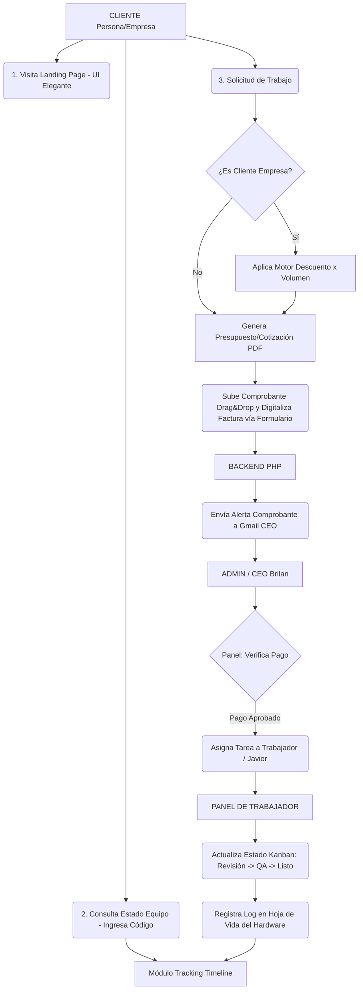

# 📄 Documentación Arquitectónica y de Diseño: Plataforma PCG

Este documento centraliza todas las decisiones técnicas, de arquitectura y diseño UI/UX discutidas para el desarrollo de la plataforma de PCG. Servirá como guía base para la implementación y como respaldo del proyecto.

## 1. Visión General y Arquitectura de Roles

El sistema consta de dos grandes bloques:
*   **Portal Público:** Landing page corporativa elegante, motor de búsqueda de estado de equipos y formulario dinámico de solicitudes.
*   **Portal Privado (Dashboard Multi-Rol):** Gestión administrativa, técnica y documental.

**Matriz de Permisos (RBAC - Role-Based Access Control):**
*   **Administrador / CEO (Brilan Bugueño):** Acceso total. Aprobación de pagos, edición del motor de descuentos, asignación de tareas a personal técnico, generación de cotizaciones y reportes.
*   **Ing. de Documentación y Procesos (Yovylin):** Emisión de cotizaciones, carga de contratos, revisión de comprobantes de pago y generación de archivos PDF.
*   **Diseñador / Staff Técnico (Javier Vergara / Trabajadores):** Panel exclusivo con tareas asignadas, cambio de estados técnicos y log de intervenciones por equipo.
*   **Cliente Empresa (B2B):** Vista corporativa con historial de equipos, solicitudes activas, cotizaciones recibidas y contratos vigentes.
*   **Cliente Particular (B2C):** Vista simplificada con historial de servicios y carga de comprobantes.

## 2. Stack Tecnológico y Despliegue (Hosting)

*   **Frontend:** React (inicializado con Vite) o Next.js configurado en modo **Static Export** (`output: 'export'`).
*   **Backend:** API REST construida en **PHP** (nativo o framework ligero).
*   **Base de Datos:** MySQL / MariaDB.
*   **Hosting:** Plan compartido en **Web Host Chile (cPanel)**.
*   **Estrategia de Despliegue:**
    *   El Frontend se compila en local (archivos HTML/CSS/JS estáticos) y se sube vía FTP o Administrador de Archivos a la raíz `public_html`. Esto garantiza máxima velocidad y compatibilidad en cPanel.
    *   El Backend (PHP) se aloja en el mismo servidor (ej. subcarpeta `public_html/api/`) procesando la lógica de negocio, bases de datos y correos.

## 3. Guía de Estilo y UI/UX (Diseño Premium)

El objetivo visual es proyectar una imagen corporativa de alto nivel, sólida y moderna (estilo Silicon Valley, simulando un equipo de desarrollo masivo).

*   **Tema Base:** Modo Oscuro (Dark Theme) para un look tecnológico y elegante.
    *   *Fondo principal:* Gris pizarra profundo (Ej. `#0f172a`).
    *   *Tarjetas/Paneles:* Gris ligeramente más claro (Ej. `#1e293b`).
*   **Colores de Acento (Extraídos del Logo PCG):**
    *   **Verde PCG:** Color primario para llamadas a la acción (Botones "Guardar", "Aprobar", estado "Listo").
    *   **Rojo PCG:** Color secundario para alertas, fallos, o detalles sutiles de UI.
*   **Tipografía:**
    *   *Títulos y Encabezados:* **Outfit** o **Geist Sans** (Geométrica, limpia).
    *   *Cuerpo de Texto y Tablas:* **Inter** (Máxima legibilidad corporativa).
*   **Diseño de Secciones:**
    *   *Sección "Nuestro Equipo" (Zig-Zag):* Formato alternado (50%/50%) para presentar a Brilan, Yovylin y Javier.
*   **Efectos y Micro-interacciones (Framer Motion / GSAP):**
    *   **Glassmorphism:** Modales y menús con desenfoque de fondo.
    *   **Scroll Reveal:** Elementos que aparecen suavemente (`opacity` y `translateX`) al hacer scroll.
    *   **Hover Effects:** Micro-escalado y resplandor radial tras las fotos/tarjetas al pasar el ratón.

## 4. Módulos Críticos del Sistema

1.  **Tracking y Línea de Tiempo (Público):**
    *   Buscador rápido por Código Único (ej: PCG-2026-8921) o RUT.
    *   Estados: Recibido/Taller ➔ Revisión/Diagnóstico ➔ Reparación/Desarrollo ➔ QA (Pruebas) ➔ Listo para Entrega.
2.  **Registro Técnico Adaptativo y Motor de Descuentos (B2B/B2C):**
    *   Formulario inteligente con condicionales para Empresas vs Personas Naturales.
    *   **Captura de Hardware Detallado:** Al registrar un equipo, el sistema exige especificaciones clave: *Procesador (CPU), Tipo de Disipación (Líquida o por Aire), Memoria RAM y Tarjeta Gráfica (si posee).*
    *   **Control de Mantenciones Previas:** Selector para indicar si el equipo ingresa por mantención, solicitando la *Fecha de la Última Mantención* para tener un contexto claro del equipo.
    *   Reglas paramétricas para descuento automático por volumen (Ej: 3 a 5 equipos = 25% dcto).
3.  **Cotizaciones Automáticas, Pagos y Facturación:**
    *   Generador de PDF para clientes frecuentes y nuevos.
    *   Integración vía API Gmail / SMTP para despacho automático (con CCO a la empresa).
    *   Dropzone para subir comprobantes (hasta 10MB) y validación manual desde el dashboard de CEO.
    *   **Gestión de Facturas:** Formulario integrado para registrar los datos de facturación de cada servicio, permitiendo digitalizar y adjuntar la factura final para el respaldo de la empresa y del cliente.
4.  **Panel Interno (Dashboard):**
    *   Tablero Kanban global para administración de proyectos.
    *   Vistas limpias exclusivas por trabajador con formulario rápido para adjuntar "Notas del Diagnóstico" a la hoja de vida del equipo.

## 5. Arquitectura de Base de Datos (Modelo ER Extendido)

Fusión del modelo base de negocio con la arquitectura específica de hardware:

```sql
-- TABLA DE USUARIOS Y ROLES
CREATE TABLE usuarios (
    id_usuario INT PRIMARY KEY AUTO_INCREMENT,
    nombre VARCHAR(100) NOT NULL,
    email VARCHAR(100) UNIQUE NOT NULL,
    password_hash VARCHAR(255) NOT NULL,
    rol ENUM('ADMIN', 'DOC_PROCESS', 'WORKER', 'CLIENTE_PERSONA', 'CLIENTE_EMPRESA') NOT NULL,
    telefono VARCHAR(20),
    creado_en TIMESTAMP DEFAULT CURRENT_TIMESTAMP
);

-- PERFILES DE EMPRESA (B2B)
CREATE TABLE clientes_empresa (
    id_empresa INT PRIMARY KEY AUTO_INCREMENT,
    id_usuario INT,
    razon_social VARCHAR(150) NOT NULL,
    rut_empresa VARCHAR(20) UNIQUE NOT NULL,
    giro VARCHAR(100),
    FOREIGN KEY (id_usuario) REFERENCES usuarios(id_usuario)
);

-- REGISTRO DE EQUIPOS Y COMPONENTES HARDWARE
CREATE TABLE equipos_componentes (
    id_equipo INT PRIMARY KEY AUTO_INCREMENT,
    id_usuario INT NOT NULL, 
    id_equipo_padre INT NULL, -- Permite vincular componentes menores (GPU) a un equipo mayor (Desktop)
    tipo_hardware ENUM('DESKTOP', 'LAPTOP', 'TARJETA_GRAFICA', 'PLACA_MADRE', 'SERVIDOR', 'WEBAPP', 'OTRO') NOT NULL,
    marca VARCHAR(50) NOT NULL,
    modelo VARCHAR(100) NOT NULL,
    numero_serie VARCHAR(100),
    
    -- DATOS DE HARDWARE CLAVE (Extraídos del JSON para fácil filtrado y reportes)
    procesador VARCHAR(150),
    ram_gb INT,
    tipo_disipacion ENUM('AIRE', 'LIQUIDA', 'STOCK', 'OTRO') DEFAULT 'STOCK',
    tarjeta_grafica VARCHAR(150),
    
    especificaciones_json JSON, -- Atributos dinámicos extra (ej: Watts de Fuente de poder, Tipo de placa madre)
    fecha_ultima_mantencion DATE NULL, -- Control de cuándo fue intervenido por última vez
    fotos_recepcion_json JSON, -- Respaldo visual del estado físico al recibir
    estado_ubicacion ENUM('EN_PODER_CLIENTE', 'EN_TALLER_PCG', 'DADO_DE_BAJA') DEFAULT 'EN_PODER_CLIENTE', 
    fecha_registro TIMESTAMP DEFAULT CURRENT_TIMESTAMP,
    FOREIGN KEY (id_usuario) REFERENCES usuarios(id_usuario),
    FOREIGN KEY (id_equipo_padre) REFERENCES equipos_componentes(id_equipo) ON DELETE SET NULL
);

-- SOLICITUDES, ÓRDENES DE TRABAJO Y PAGOS
CREATE TABLE solicitudes (
    id_solicitud INT PRIMARY KEY AUTO_INCREMENT,
    codigo_seguimiento VARCHAR(20) UNIQUE NOT NULL, -- Código público para el Timeline
    id_usuario INT NOT NULL,
    id_equipo INT,
    id_tecnico_asignado INT,
    tipo_servicio ENUM('MANTENIMIENTO', 'DESARROLLO', 'UPGRADE', 'CONSULTORIA'),
    estado ENUM('RECIBIDO', 'EN_REVISION', 'EN_DESARROLLO', 'EN_QA', 'LISTO', 'ENTREGADO') DEFAULT 'RECIBIDO',
    estado_pago ENUM('PENDIENTE', 'VERIFICANDO', 'PAGADO') DEFAULT 'PENDIENTE',
    comprobante_url VARCHAR(255),
    -- FACTURACIÓN Y DIGITALIZACIÓN
    requiere_factura BOOLEAN DEFAULT FALSE,
    numero_factura VARCHAR(50),
    factura_url VARCHAR(255), -- Ruta de la factura digitalizada
    datos_facturacion_json JSON, -- Detalles (RUT, Razón Social usada para la factura)
    total DECIMAL(10,2),
    descuento_aplicado DECIMAL(5,2) DEFAULT 0.00,
    creado_en TIMESTAMP DEFAULT CURRENT_TIMESTAMP,
    FOREIGN KEY (id_usuario) REFERENCES usuarios(id_usuario),
    FOREIGN KEY (id_equipo) REFERENCES equipos_componentes(id_equipo),
    FOREIGN KEY (id_tecnico_asignado) REFERENCES usuarios(id_usuario)
);

-- HOJA DE VIDA HISTÓRICA DEL EQUIPO (BITÁCORA)
CREATE TABLE historial_intervenciones (
    id_intervencion INT PRIMARY KEY AUTO_INCREMENT,
    id_equipo INT NOT NULL,
    id_solicitud INT,
    id_tecnico INT NOT NULL, 
    tipo_intervencion ENUM('PREVENTIVO', 'CORRECTIVO', 'REPARACION_ELECTRONICA', 'UPGRADE', 'SOFTWARE') NOT NULL,
    titulo_trabajo VARCHAR(150) NOT NULL, 
    detalle_tecnico TEXT NOT NULL, 
    temperaturas_o_pruebas TEXT, 
    documentos_adjuntos_json JSON, -- Certificados PDF
    fecha_vencimiento_garantia DATE NULL, 
    fecha_intervencion TIMESTAMP DEFAULT CURRENT_TIMESTAMP,
    FOREIGN KEY (id_equipo) REFERENCES equipos_componentes(id_equipo),
    FOREIGN KEY (id_solicitud) REFERENCES solicitudes(id_solicitud),
    FOREIGN KEY (id_tecnico) REFERENCES usuarios(id_usuario)
);

-- REGLAS DE DESCUENTO
CREATE TABLE reglas_descuento (
    id_regla INT PRIMARY KEY AUTO_INCREMENT,
    min_equipos INT NOT NULL,
    max_equipos INT NOT NULL,
    porcentaje_descuento DECIMAL(5,2) NOT NULL,
    activo BOOLEAN DEFAULT TRUE
);
```

## 6. Diagrama de Flujo Lógico del Sistema


